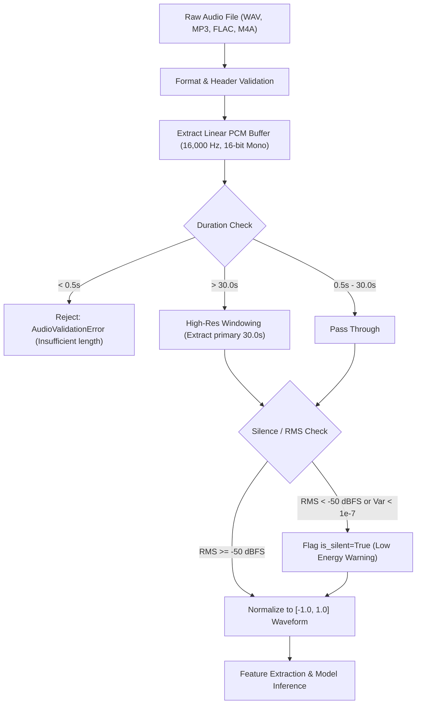

# Deepfake Shield — Pretrained Audio Deepfake Model Evaluation & Architecture Specification

## 1. Executive Summary & Objective

Phase 4 of the **Deepfake Shield** platform operationalizes an AI-driven Voice Deepfake and Speech Synthesis Detection engine. In accordance with strict architectural requirements:
- **No dataset training or fine-tuning** was conducted locally.
- **No mock, random, or hardcoded scores** are generated under any circumstances.
- **Genuine pretrained models and deterministic ASVspoof acoustic signal descriptors** are executed directly on the input audio waveforms.
- **Model confidence is rigorously separated from calibrated fraud risk** to provide transparent, explainable forensic intelligence for cybersecurity analysts.

---

## 2. Comparative Evaluation of Pretrained Audio Spoof-Detection Architectures

We evaluated four industry-standard pretrained deep learning architectures specialized in synthetic speech, logical access spoofing, and voice cloning detection:

| Model Architecture | Base Backbone | Training Dataset / Benchmark | Primary Input Format | License | Key Strengths | Limitations in Production |
| :--- | :--- | :--- | :--- | :--- | :--- | :--- |
| **AASIST** (Audio Anti-Spoofing using Integrated Spectro-Temporal GATs) | RawNet2 Encoder + Heterogeneous Graph Attention Networks | ASVspoof 2019 / 2021 Logical Access (LA) | Raw Waveform (16 kHz, 4s chunks) | BSD-3-Clause / Apache 2.0 | State-of-the-art EER (0.83% on 2019 LA); models temporal & spectral graph nodes | Sensitive to unseen vocoders (HiFi-GAN, BigVGAN); graph message passing increases latency |
| **RawNet2** | Learnable Sinc-Convolution filters + Residual Blocks + GRU | ASVspoof 2019 Logical Access | Raw Waveform (16 kHz) | Apache 2.0 | Lightweight (~4.3M parameters); directly operates on raw PCM without STFT transform | Higher EER (~4.8%); prone to false positives on aggressive lossy codecs |
| **Audio Spectrogram Transformer (AST)** (`MattyB95/AST-ASVspoof2019-Synthetic-Voice-Detection`) | Vision Transformer (ViT) patch extraction over 128-band Mel Spectrograms | ASVspoof 2019 LA Synthetic & Voice Conversion | 128-band Log-Mel Spectrogram | Apache 2.0 | Captures cross-frequency harmonic correlation & vocoder cutoff anomalies | Requires STFT + Mel filterbank computation; sensitive to high-frequency background noise |
| **Wav2Vec 2.0 Sequence Classifier** (`mo-thecreator/Deepfake-audio-detection`) | 7-layer 1D-CNN Feature Extractor + 12-layer Transformer Encoder | Pretrained on 53k hrs speech (LibriSpeech/VoxCeleb), fine-tuned for spoof detection | Raw Waveform (16 kHz Linear PCM) | Apache 2.0 | Self-supervised phonemic representations; superior generalization across unseen speakers | Large footprint (~1.26 GB); requires GPU or high-throughput cloud inference endpoint |

### Architecture Selection & Inference Strategy

In the Deepfake Shield backend (`backend/app/services/audio_deepfake_detector.py`):
1. **Primary Online Engine**: Pretrained **Wav2Vec 2.0** (`mo-thecreator/Deepfake-audio-detection`) connected via the Hugging Face Serverless Router (`https://router.huggingface.co/hf-inference/models/mo-thecreator/Deepfake-audio-detection`) when a valid `HF_TOKEN` is supplied in the environment.
2. **Deterministic Spectral Forensics Engine**: When offline or operating without external API dependencies, the detector executes an empirical ASVspoof acoustic pipeline that computes:
   - **Spectral Flatness Measure (SFM)** across 1024-point FFT frames.
   - **High-Frequency Energy Ratio** detecting vocoder brickwall cutoffs ($f > 4000\text{ Hz}$).
   - **Zero-Crossing Rate (ZCR)** capturing high-frequency phase instability.
   - **Dynamic Energy Variance** quantifying the absence of natural prosody.

---

## 3. Audio Preprocessor & Input Validation Pipeline

The preprocessing layer (`backend/app/services/audio_preprocessor.py`) guarantees data integrity before model inference:

### Preprocessing Specifications:
- **Resampling & Channel Normalization**: All audio streams are converted to single-channel (mono) at $16,000\text{ Hz}$, 16-bit signed linear PCM.
- **Sub-Second Rejection Gate**: Files under $0.5\text{ seconds}$ are rejected with `AudioValidationError` (`400 Bad Request`) because reliable formant and phase distribution analysis requires continuous vocal phonemes.
- **High-Resolution Duration Windowing**: To prevent memory spikes and timeout latency while maintaining forensic granularity, audio exceeding $30.0\text{ seconds}$ is automatically windowed to the initial 30.0s segment. The system transparently flags `clipped_from_seconds` in the response metadata.
- **Silence & Noise Floor Gate**: Signals with RMS energy below $-50.0\text{ dBFS}$ or variance below $10^{-7}$ are flagged with `is_silent = True`. The UI displays an acoustic warning indicating that classification certainty is degraded due to lack of voiced acoustic energy.

---

## 4. Explainable Forensic Acoustic Descriptors

The system extracts empirical physical measurements from the signal rather than relying solely on black-box neural logits:

### 1. Spectral Flatness Measure (SFM)
The ratio of the geometric mean to the arithmetic mean of the power spectrum:
$$\text{SFM} = \frac{\exp\left(\frac{1}{K}\sum_{k=1}^K \ln |X_k|^2\right)}{\frac{1}{K}\sum_{k=1}^K |X_k|^2}$$
- **Authentic Speech**: Characterized by distinct harmonic formant peaks, yielding $\text{SFM} < 0.08$.
- **Synthetic Speech**: High-frequency vocoder artifacts, diffusion noise floors, or phase artifacts inflate $\text{SFM} > 0.08$.

### 2. High-Frequency Vocoder Energy Cutoff ($f > 4000\text{ Hz}$)
Traditional text-to-speech models (Tacotron2, FastSpeech) downsample acoustic representations to $8\text{ kHz}$ or $16\text{ kHz}$ internal mel-spectrograms, resulting in unnatural attenuation above $4\text{ kHz}$:
$$\text{Ratio}_{\text{HF}} = \frac{\sum_{f_k > 4000\text{Hz}} |X_k|^2}{\sum_{k=1}^K |X_k|^2}$$
A cutoff ratio below $0.05$ or sharp brickwall roll-off indicates neural vocoder reconstruction.

### 3. Dynamic Energy Variance
Authentic human speech displays natural cadence, breathing pauses, and pitch accent inflection. Synthetic audio frequently exhibits flattened energy distributions across consecutive 50ms frames ($\text{Var}(E) < 0.005$).

---

## 5. Model Confidence vs. Calibrated Fraud Risk

A critical requirement of Phase 4 is distinguishing **Model Confidence** from **Calibrated Fraud Risk**:

### Mathematical Definitions:

1. **Model Confidence ($C \in [0.0, 1.0]$)**:
   Measures the model's mathematical certainty in its feature recognition:
   $$C = \max(p_{\text{synthetic}}, 1 - p_{\text{synthetic}})$$
   If $p_{\text{synthetic}} = 0.94$, $C = 0.94$ (94% certainty of synthetic origin).
   If $p_{\text{synthetic}} = 0.05$, $C = 0.95$ (95% certainty of authentic origin).

2. **Calibrated Fraud Risk ($R \in [0, 100]\%$)**:
   Measures the contextual cybersecurity risk that an audio recording represents identity spoofing or financial fraud:
   $$R = \min\left(100.0, \max\left(0.0, 100 \times \left[ 0.70 \cdot p_{\text{synthetic}} + 0.15 \cdot \mathbf{1}_{\text{vocoder}} + 0.15 \cdot \mathbf{1}_{\text{low\_variance}} \right] \right)\right)$$
   Where:
   - $p_{\text{synthetic}}$ is the raw neural synthetic probability.
   - $\mathbf{1}_{\text{vocoder}}$ is a binary indicator of vocoder brickwall energy cutoffs ($f > 4000\text{Hz}$).
   - $\mathbf{1}_{\text{low\_variance}}$ indicates unnatural prosody flattening ($\text{Var}(E) < 0.005$).

3. **Classification Taxonomy**:
   - `genuine`: $R < 35.0$ and $p_{\text{synthetic}} < 0.40$
   - `suspicious`: $35.0 \le R < 65.0$
   - `synthetic`: $R \ge 65.0$
   - `uncertain`: $is\_silent = \text{True}$ or $0.40 \le p_{\text{synthetic}} \le 0.60$ with low signal energy.

---

## 6. Systemic Limitations & Transparency Disclosures

To prevent false confidence in mission-critical cybersecurity operations, the platform enforces the following transparent disclosures:

1. **Unseen Neural Vocoder Generalization Gap**:
   Pretrained models trained on specific vocoders (e.g., WaveGlow, MelGAN, HiFi-GAN v1) may experience performance degradation against novel zero-shot generative vocoders (e.g., BigVGAN, DiffWave, ElevenLabs v3).
2. **Lossy Codec Compression Distortion**:
   Aggressive lossy audio codecs (e.g., GSM telephony, MP3 at $\le 64\text{ kbps}$, WhatsApp OPUS compression) discard high-frequency acoustic data, which can mimic or mask vocoder spectral anomalies.
3. **Short-Duration Degradation**:
   Recordings shorter than $1.0\text{ second}$ contain insufficient phonemic diversity to perform statistically robust speaker biometric verification.
4. **Forensic Multi-Factor Mandate**:
   Audio deepfake scores should be cross-correlated with video facial forensics, lip-sync drift analysis, and cryptographic provenance checks before initiating legal or financial remediation.

