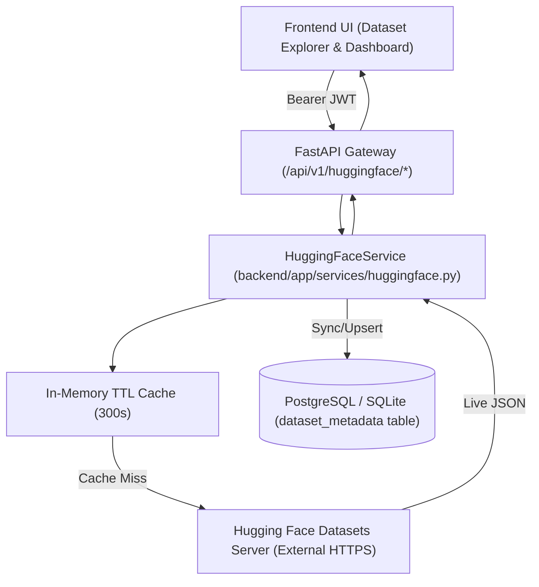

# Deepfake Shield – Hugging Face API Integration (Phase 3)

## 1. Overview & Objective
Phase 3 integrates live dataset intelligence into Deepfake Shield by connecting to the **Hugging Face Datasets Server API** and **Hugging Face Hub API** for `UniDataPro/deepfake-videos-dataset`.

This integration operates strictly as an **ephemeral metadata and preview stream**:
- **Zero Local Bulk Downloading**: The multi-gigabyte raw dataset is never downloaded to disk.
- **No Local Model Training or Fine-Tuning**: No neural network training loops or dataset ingestion jobs are run.
- **Empirical Ground-Truth Verification**: Actual labels and video references are fetched live via HTTP requests from Hugging Face APIs.
- **License Compliance**: Adheres to `cc-by-nc-nd-4.0` (Creative Commons Attribution-NonCommercial-NoDerivatives 4.0 International).

---

## 2. Integrated Hugging Face Endpoints

### 2.1 Splits Endpoint
- **URL**: `https://datasets-server.huggingface.co/splits?dataset=UniDataPro%2Fdeepfake-videos-dataset`
- **Purpose**: Lists configurations and dataset partitions.
- **Empirical Response**:
  ```json
  {
    "splits": [
      {
        "dataset": "UniDataPro/deepfake-videos-dataset",
        "config": "default",
        "split": "train"
      }
    ],
    "pending": [],
    "failed": []
  }
  ```

### 2.2 Rows Endpoint
- **URL**: `https://datasets-server.huggingface.co/rows?dataset=UniDataPro%2Fdeepfake-videos-dataset&config=default&split=train&offset=0&length=100`
- **Purpose**: Retrieves paginated ground-truth rows with direct media references and class classifications.
- **Empirical Schema & Findings**:
  - `features`:
    - `video`: `Video` object (`{"src": "https://huggingface.co/datasets/UniDataPro/deepfake-videos-dataset/resolve/.../deepfake/1.mp4"}`)
    - `label`: `ClassLabel` with classes:
      - `0`: `"deepfake"` (Manipulated face-swap / synthetic reenactment)
      - `1`: `"video"` (Authentic organic video capture)
  - `num_rows_total`: 10 rows in server preview (5 deepfakes, 5 authentic videos).

### 2.3 Parquet Partition Endpoint
- **URL**: `https://huggingface.co/api/datasets/UniDataPro/deepfake-videos-dataset/parquet/default/train`
- **Purpose**: Provides URLs to partitioned binary Parquet files.
- **Empirical Response**:
  ```json
  [
    "https://huggingface.co/api/datasets/UniDataPro/deepfake-videos-dataset/parquet/default/train/0.parquet"
  ]
  ```

### 2.4 Dataset Metadata Hub Endpoint
- **URL**: `https://huggingface.co/api/datasets/UniDataPro/deepfake-videos-dataset`
- **Purpose**: Provides dataset card tags, license (`cc-by-nc-nd-4.0`), author, and description.

---

## 3. Backend Architecture & Caching Strategy



### Rate Limiting & TTL Caching
- **Memory TTL Cache**: Cached in Python memory for 300 seconds (`settings.HF_CACHE_TTL_SECONDS`).
- **PostgreSQL Database Storage**: Metadata is persisted in `dataset_metadata` table for offline resilience and auditability.
- **Degraded State Fallback**: When Hugging Face returns HTTP 429 (Too Many Requests), the service seamlessly returns the cached PostgreSQL metadata with status `degraded`.

---

## 4. API Endpoints Exposed by FastAPI

| Method | Endpoint | Query Parameters | Description |
| :--- | :--- | :--- | :--- |
| `GET` | `/api/v1/huggingface/status` | `dataset` (optional) | Real-time health check, latency measurement, and token auth check |
| `GET` | `/api/v1/huggingface/splits` | `dataset` (optional) | Available splits and configurations |
| `GET` | `/api/v1/huggingface/parquet` | `dataset`, `config`, `split` | Parquet file URLs |
| `GET` | `/api/v1/huggingface/rows` | `offset`, `length`, `config`, `split` | Paginated ground-truth rows with mapped labels |
| `GET` | `/api/v1/huggingface/metadata` | `dataset` (optional) | Combined metadata (checks DB cache before calling HF) |
| `POST` | `/api/v1/huggingface/sync` | `dataset` (optional) | Force-refreshes metadata and upserts into database |

---

## 5. Security & Credential Hygiene
- **Environment Variable**: Optional Hugging Face User Access Token configured via `HF_TOKEN` in `.env`.
- **Zero Frontend Leakage**: The token is never passed to or exposed in the frontend. All client requests communicate with the authenticated FastAPI backend.
- **RBAC Guard**: All `/api/v1/huggingface/*` endpoints require an active Security Analyst JWT token.

---

## 6. Limitations & Boundaries
1. **Preview Dataset Scope**: The Hugging Face Datasets Server provides a representative sample preview of 10 rows for interactive inspection.
2. **CDN Streaming Constraints**: Video files are streamed on-demand from `https://huggingface.co/datasets/.../resolve/...`. Media loading latency depends on user bandwidth and Hugging Face CDN routing.
3. **Parquet File Nature**: Parquet files are columnar data partitions containing embedded binary blobs or metadata pointers; they are not direct playable video URLs.
4. **License Restriction**: `cc-by-nc-nd-4.0` prohibits commercial redistribution or modification of raw video assets.

---

## 7. Phase 4 Pretrained Model Integration Readiness
Phase 3 lays the architectural groundwork for Phase 4:
- The ground-truth labels (`0 = deepfake`, `1 = video`) serve as verifiable test targets for pretrained neural backbones (**AASIST**, **EfficientNet-B4**, and **SyncNet**).
- When Phase 4 models are loaded, single benchmark clips can be evaluated on-the-fly via the API without downloading the entire dataset repository.

