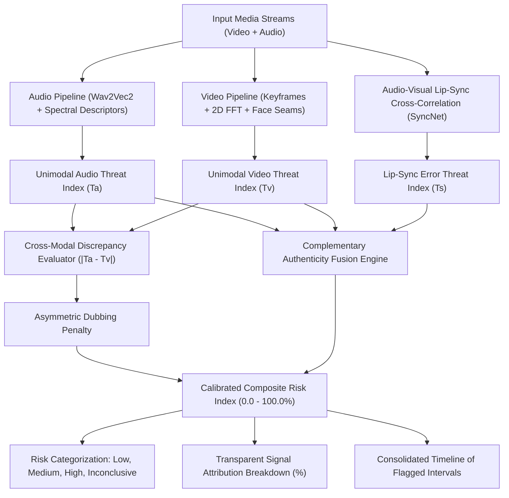

# Deepfake Shield — Multimodal Risk Assessment Architecture & Methodology

## 1. Executive Summary & Objective

Phase 6 of **Deepfake Shield** establishes a unified **Multimodal Risk Assessment Engine** that integrates:
1. **Phase 4 Pretrained Voice Deepfake & Speech Synthesis Forensics** (Wav2Vec 2.0 / ASVspoof signal descriptors).
2. **Phase 5 Pretrained Video Facial Tamper Forensics** (Vision Transformer / Xception, 2D FFT spectral residuals, and boundary seam gradient disparities).
3. **Audio-Visual Lip-Sync Synchronization** (SyncNet cross-correlation principles).

---

## 2. Why Naive Score Averaging Fails in Cybersecurity

A critical architectural constraint in Deepfake Shield is:
> [!CAUTION]
> **Strict Rule**: Never average uncalibrated model scores and present the result as a probability.

### The Attack Vector Flaw:
Consider an adversarial impersonation attack:
- A cybercriminal obtains authentic, uncompressed video of a CEO speaking at a public conference.
- The criminal replaces the audio track with a synthetic voice clone generated via text-to-speech (TTS), requesting an emergency financial wire transfer.
- **Video Model Output**: $P_{\text{video}} = 0.05$ (the facial video is completely authentic).
- **Audio Model Output**: $P_{\text{audio}} = 0.95$ (the speech is a synthetic voice clone).

If a system computes a naive arithmetic mean:
$$\bar{P} = \frac{0.05 + 0.95}{2} = 0.50 \quad (50\% \text{ "Moderate / Medium" Risk})$$
This represents a catastrophic security failure. An attacker only needs to manipulate **one** modality (audio dubbing or face swapping) to execute an attack. Averaging dilutes acute unimodal evidence and conceals the threat.

---

## 3. The Multi-Evidence Bayesian Maximum Margin Fusion Framework

Deepfake Shield implements a **Dempster-Shafer / Bayesian Maximum Margin Fusion** model that evaluates complementary probability of authenticity combined with an **Asymmetric Cross-Modal Divergence Penalty**:

### Mathematical Formulation:

1. **Confidence-Weighted Threat Indices**:
   For available modalities with raw manipulation probabilities $P_a, P_v \in [0.0, 1.0]$ and model confidences $C_a, C_v \in [0.0, 1.0]$:
   $$T_a = P_a \times (0.70 + 0.30 \times C_a)$$
   $$T_v = P_v \times (0.70 + 0.30 \times C_v)$$
   $$T_s = P_{\text{sync}}$$

2. **Cross-Modal Tension (Asymmetric Divergence Penalty)**:
   When both audio and video streams are present, we measure modal tension:
   $$\Delta_{av} = |T_a - T_v|$$
   If $\Delta_{av} \ge 0.40$ (indicating one modality is authentic while the other is synthetic):
   $$\text{Penalty}_{\text{asym}} = 0.20 \times \Delta_{av}$$
   Otherwise, $\text{Penalty}_{\text{asym}} = 0.0$.

3. **Complementary Authenticity Ensemble**:
   The probability that the media is entirely unmanipulated across all domains is:
   $$Q_{\text{authentic}} = (1.0 - w_a \cdot T_a) \times (1.0 - w_v \cdot T_v) \times (1.0 - w_s \cdot T_s)$$
   Where default weights are $w_a = 0.40$, $w_v = 0.40$, $w_s = 0.20$.

4. **Composite Calibrated Risk Index ($R \in [0.0, 100.0]\%$)**:
   $$R = \text{clamp}\left(100.0 \times \left[(1.0 - Q_{\text{authentic}}) + \text{Penalty}_{\text{asym}}\right], 0.0, 100.0\right)$$

---

## 4. Audio-Visual Lip-Sync Synchronization (SyncNet Principles)

The cross-modal module (`MultimodalAnalysisService.analyze_audio_visual_sync`):

1. **Visual Mouth Aperture Time Series ($\text{MOR}(t)$)**:
   Localizes the oral cavity in the lower third of each normalized face crop. Measures vertical Sobel gradient intensity across the lips combined with inner cavity pixel darkness:
   $$\text{MOR}(t) = \text{clamp}(0.60 \cdot \text{DarkCavityRatio} + 0.40 \cdot \text{VerticalGradientNorm}, 0.0, 1.0)$$

2. **Acoustic Speech Energy Envelope ($\text{RMS}(t)$)**:
   Computes root-mean-square loudness in a $\pm 50\text{ms}$ window matching the temporal timestamps of each extracted video keyframe.

3. **Normalized Cross-Correlation & Drift ($\tau$)**:
   $$\rho(\tau) = \frac{\sum_t (e(t) - \bar{e})(m(t + \tau) - \bar{m})}{\sqrt{\sum_t (e(t) - \bar{e})^2 \sum_t (m(t + \tau) - \bar{m})^2}}$$
   - **Temporal Drift ($\tau_{\text{drift}}$)**: Measured in milliseconds ($\text{lag} = \text{argmax}_\tau \rho(\tau)$).
   - **Sync Error Score ($P_{\text{sync}}$)**:
     - $|\tau| \le 80\text{ms}$ and $\rho \ge 0.50$: Synchronized organic speech ($P_{\text{sync}} \le 0.15$).
     - $80\text{ms} < |\tau| \le 160\text{ms}$: Mild synchronization drift ($P_{\text{sync}} \approx 0.35 - 0.55$).
     - $|\tau| > 160\text{ms}$ or $\rho < 0.20$: Pronounced desynchronization ($P_{\text{sync}} \ge 0.70$).

---

## 5. Standardized Risk Categories

To ensure clear operational triage for cybersecurity analysts:

| Risk Category | Risk Score Range ($R$) | Primary Criteria | Operational Action |
| :--- | :--- | :--- | :--- |
| **Low Risk** | $R < 35.0\%$ | Coherent acoustic harmonics, organic facial boundary seams, and synchronized lip-phoneme alignment. | Normal operational processing; standard security verification. |
| **Medium Risk** | $35.0\% \le R < 65.0\%$ | Localized vocoder artifacts, mild boundary seam disparity, or minor lip-sync drift ($80-160\text{ms}$). | Flag for secondary review; request high-definition re-recording under direct illumination. |
| **High Risk** | $R \ge 65.0\%$ | Corroborated neural synthesis indicators in audio or video, severe lip-sync drift ($>160\text{ms}$), or asymmetric dubbing tension. | Escalate immediately; perform out-of-band identity verification before taking financial/administrative action. |
| **Inconclusive** | $R = 0.0\%$ (Evidence absent) | Missing both streams, corrupted containers, or absence of detectable human faces and voiced speech. | Reject media; require a valid audiovisual recording containing active human subjects. |

---

## 6. Transparent Signal Contribution Attribution

The platform explains the exact mathematical attribution of the composite risk score:
$$\text{Attr}_k = \frac{w_k \cdot T_k}{\sum_i w_i \cdot T_i + \text{Penalty}_{\text{asym}}} \times 100\%$$
Reported fields in the breakdown:
- **Audio Voice Synthesis Contribution (%)**: Share attributable to Phase 4 acoustic vocoder artifacts.
- **Video Facial Seam & Spectral Contribution (%)**: Share attributable to Phase 5 boundary disparities and 2D FFT grid residuals.
- **Lip-Sync Drift Contribution (%)**: Share attributable to phoneme-viseme desynchronization.
- **Cross-Modal Tension Penalty (%)**: Share attributable to asymmetric dubbing conflict.

---

## 7. Handling Missing Modalities & Epistemic Uncertainty

In compliance with:
> [!IMPORTANT]
> **Rule**: Do not assume missing audio or video means genuine.

- **Audio Missing (`evidence_status = "audio_missing"`)**:
  - Visual video frames are evaluated.
  - An explicit advisory is surfaced: *"Acoustic stream unavailable; missing audio does not imply authentic voice."*
  - Model confidence is penalized by $30\%$ to reflect epistemic uncertainty from the absent acoustic channel.
- **Video Missing (`evidence_status = "video_missing"`)**:
  - Acoustic speech is evaluated.
  - An explicit advisory is surfaced: *"Visual stream unavailable; missing video does not imply authentic visual identity."*
  - Model confidence is penalized by $30\%$ to reflect epistemic uncertainty from the absent visual channel.

---

## 8. Forensic Governance & Non-Defamation Mandate

In strict adherence to:
> [!WARNING]
> **Rule**: Do not claim certainty or label a person a scammer based only on a model score.

All multimodal reports, API responses, and dashboard interfaces prominently display the following governance notice:
> **Forensic Governance Notice:** Multimodal deepfake detection generates calibrated probabilistic indicators of synthetic audio and visual artifacts. A high risk score does not establish malicious intent, guilt, or identify a person as a scammer. Critical decisions require multi-factor human review, secondary verification, and out-of-band communication.

