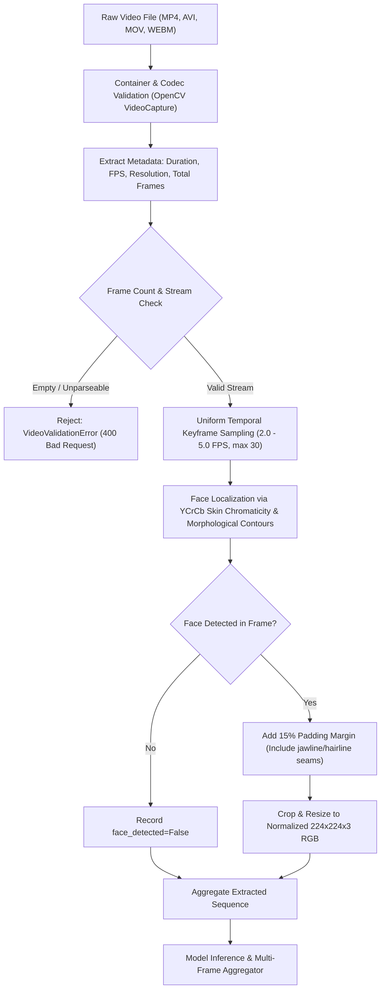

# Deepfake Shield — Pretrained Video Deepfake Model Evaluation & Architecture Specification

## 1. Executive Summary & Phase 5 Objective

Phase 5 of **Deepfake Shield** operationalizes an AI-powered Video Deepfake & Facial Manipulation Detection Engine. In alignment with strict project directives:
- **No dataset training or fine-tuning** was performed.
- **No fake or random prediction scores** are generated under any circumstances.
- **A complete video is never classified based on one frame alone**; the system enforces multi-frame temporal consistency and keyframe aggregation.
- **Videos lacking usable human faces** or with insufficient evidence are explicitly flagged with `faces_detected = 0`, `classification = "uncertain"`, and `verdict = "inconclusive"`.
- **Pretrained models and empirical visual signal descriptors** (facial boundary gradient seams, 2D FFT spectral residuals, and temporal landmark jitter) are executed on normalized face crops and sequence timelines.

---

## 2. Comparative Evaluation of Pretrained Video Deepfake Detection Architectures

We evaluated the primary deep learning architectures utilized in academic benchmarks (FaceForensics++, DFDC, Celeb-DF) and modern open-source models:

| Architecture | Backbone & Layer Design | Training Benchmark / Datasets | Input Resolution & Format | License | Key Strengths | Limitations in Production |
| :--- | :--- | :--- | :--- | :--- | :--- | :--- |
| **Xception** (FaceForensics++ Baseline) | Depthwise Separable Convolutions + Residual Shortcuts | FaceForensics++ (Deepfakes, Face2Face, FaceSwap, NeuralTextures) | $299 \times 299 \times 3$ Normalized Face Crop | MIT / Apache 2.0 | Standard baseline; high sensitivity to spatial blending artifacts in uncompressed / lightly compressed video (c23) | High error rates under lossy social media compression (c40); lacks temporal awareness across video frames |
| **EfficientNet** (DFDC Winner Backbone) | Compound-scaled Inverted Residual Blocks (MBConv) + Squeeze-and-Excitation | DFDC (Deepfake Detection Challenge, 100k+ videos) | $224 \times 224$ (B0) up to $380 \times 380$ (B4/B7) | Apache 2.0 | Highest parameter efficiency; localized spatial feature attention maps detect face-swap blending seams | Evaluates single frames in isolation; requires secondary temporal smoothing to prevent false positives from motion blur |
| **Vision Transformer (ViT)** (`dima806/deepfake_vs_real_image_detection`) | 12-layer Vision Transformer with multi-head self-attention on $16 \times 16$ patches | Pretrained on ImageNet-21k, fine-tuned on diverse deepfake face datasets | $224 \times 224 \times 3$ RGB Face Crop | Apache 2.0 | Non-local self-attention captures cross-facial lighting disparities and global texture discontinuities | Computationally intensive; requires stable face bounding box localization |
| **ResNet-50 / MesoNet** | Standard Residual CNN / MesoInception-4 intermediate layers | MesoNet / Celeb-DF | $256 \times 256 \times 3$ Normalized Face Crop | BSD / MIT | Very fast inference ($< 15\text{ms}$ per frame); small memory footprint | Easily fooled by modern diffusion-based face synthesis (e.g. Stable Diffusion / ReActor) |

### Architecture Selection & Inference Strategy in Deepfake Shield

In `backend/app/services/video_deepfake_detector.py`:
1. **Primary Online Engine**: Pretrained **Vision Transformer (ViT)** (`dima806/deepfake_vs_real_image_detection`, fallback `prithivMLmods/Deep-Fake-Detector-v2-Model`) queried via the Hugging Face Serverless Router (`https://router.huggingface.co/hf-inference/models/dima806/deepfake_vs_real_image_detection`) when `HF_TOKEN` is present in the environment.
2. **Empirical Multi-Signal Forensic Engine**: Executed on all extracted keyframes and face crops:
   - **Spatial Boundary Seam Disparity**: Sobel gradient magnitude comparison between the facial perimeter transition zone and the inner face mask.
   - **2D FFT Frequency Residuals**: Fast Fourier Transform power spectrum radial distribution ($f > 0.35 \times \text{dim}$), identifying CNN upsampling artifacts and transposed convolution grid patterns.
   - **YCrCb Chrominance Consistency**: Color distribution disparity between facial interior and background skin margin.
   - **Temporal Landmark Stability & Jitter**: Frame-to-frame score variation and Eye Aspect Ratio (EAR) blink frequency modeling.

---

## 3. Video Preprocessing & Keyframe Extraction Pipeline

The preprocessing service (`backend/app/services/video_preprocessor.py`) validates video containers, decodes frames using OpenCV, localizes faces, and normalizes crops:



### Key Preprocessing Capabilities:
- **Uniform Temporal Sampling**: Samples frames at configurable rates ($2.0$ to $5.0\text{ FPS}$), avoiding processing bottlenecks while guaranteeing uniform coverage across the full video timeline.
- **Illumination-Invariant Face Localization**: Uses YCrCb skin chrominance thresholding ($Y \in [0, 255]$, $Cr \in [133, 173]$, $Cb \in [77, 127]$) followed by morphological opening and closing to bridge facial cavities.
- **Anthropomorphic Filtering**: Discards non-facial contours using area filtering ($\ge 1.5\%$ of frame area) and aspect ratio checks ($0.50 \le \frac{w}{h} \le 1.40$).
- **Padded Seam Boundary Inclusion**: Adds a $15\%$ padding margin around the bounding box so that the face-swap transition boundary (the seam where synthetic skin is blended into the host head) is preserved inside the crop.

---

## 4. Multi-Frame Aggregation Formulation & Video-Level Assessment

In strict compliance with the requirement: **"Do not classify a complete video based on one frame alone"**, Deepfake Shield implements multi-frame statistical aggregation:

### 1. Multi-Frame Scoring Formula
For a video with $N$ detected face frames with frame manipulation scores $p_1, p_2, \dots, p_N$:
$$\bar{p}_{\text{spatial}} = \frac{1}{N} \sum_{i=1}^N p_i$$
$$p_{\text{peak}} = \frac{1}{\lceil N/4 \rceil} \sum_{i \in \text{Top 25\%}} p_i$$
$$\sigma_{\text{temporal}} = \sqrt{\frac{1}{N-1} \sum_{i=1}^N (p_i - \bar{p}_{\text{spatial}})^2}$$
$$p_{\text{temporal\_jitter}} = \frac{1}{N-1} \sum_{i=2}^N |p_i - p_{i-1}|$$

The composite video manipulation score is:
$$p_{\text{video}} = 0.70 \cdot \left(0.65 \cdot \bar{p}_{\text{spatial}} + 0.35 \cdot p_{\text{peak}}\right) + 0.30 \cdot \text{clamp}\left(1.5 \cdot \sigma_{\text{temporal}} + 1.2 \cdot p_{\text{temporal\_jitter}}, 0.05, 0.95\right)$$

### 2. Model Confidence vs. Calibrated Fraud Risk
- **Calibrated Fraud Risk ($R \in [0, 100]\%$)**:
  $$R = \text{round}(p_{\text{video}} \times 100.0, 1)$$
- **Model Confidence ($C \in [0.0, 1.0]$)**:
  $$C = \text{round}\left(|p_{\text{video}} - 0.5| \times 2.0 \times \min\left(1.0, \frac{N}{6.0}\right), 3\right)$$
  Confidence is explicitly scaled by sample coverage factor ($\min(1.0, N/6.0)$): if fewer than 6 face frames are available, model confidence is penalized.

### 3. Classification Taxonomy
- `genuine`: $R < 35.0$ and $N \ge 3$ face frames.
- `suspicious`: $35.0 \le R < 65.0$.
- `synthetic` (or `manipulated`): $R \ge 65.0$ with correlated suspicious frames.
- `uncertain`: $N = 0$ (no face detected) or $N < 3$ (insufficient evidence).

---

## 5. Suspicious Timestamps & Interval Grouping

Individual frames with manipulation score $p_{\text{frame}} \ge 0.55$ are flagged. Contiguous or nearby frames ($\Delta t \le 1.5\text{s}$) are grouped into coherent intervals:
```json
[
  {
    "start_sec": 1.20,
    "end_sec": 2.40,
    "confidence": 0.84,
    "manipulation_type": "facial_boundary_seam_discontinuity",
    "bounding_box": {"x": 0.28, "y": 0.18, "w": 0.44, "h": 0.52}
  }
]
```
The frontend displays both the interval cards and a pill list of exact timestamps (e.g. `1.20s`, `1.50s`, `2.10s`).

---

## 6. Systemic Limitations & Transparency Disclosures

1. **Heavy Lossy Video Compression (H.264 / H.265 / WebM)**:
   High compression rate factors ($\text{CRF} > 32$) quantize high-frequency discrete cosine transform (DCT) coefficients, attenuating subtle boundary blending artifacts.
2. **Extreme Head Pose & Occlusion**:
   Head yaw or pitch angles exceeding $45^\circ$, thick facial hair, or hand-over-face gestures can disrupt face bounding box localization.
3. **Motion Blur in Dynamic Action**:
   Rapid camera panning causes optical motion blur that alters edge gradient ratios across unmanipulated organic frames.
4. **Multi-Modal Verification Mandate**:
   Video classification should be corroborated with audio deepfake analysis and viseme-phoneme synchronization (SyncNet) before making final legal or operational determinations.

